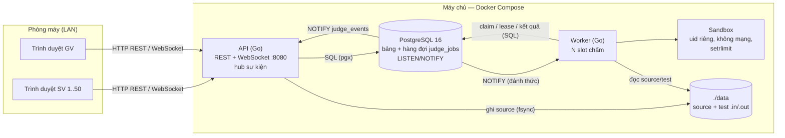

# NETWORK PROGRAMMING – FINAL PROJECT

> **Academic Year 2026–2027**

---

# 1. Project Information

## 1.1. Project Name

**LAN Auto-Grader** — hệ thống thi và chấm tự động bài lập trình C++ qua mạng LAN (backend).

## 1.2. Topic

**Chủ đề 3 – Ứng dụng mạng, định hướng 4.5 "Networked Auto-Grader"** (`Topics.md`).

## 1.3. Group

> Nhóm điền thông tin thành viên (không tự điền thay).

| No. | Student ID | Full Name | Email | Main Responsibility | Contribution |
| --- | ---------- | --------- | ----- | ------------------- | -----------: |
| 1   | ...        | ...       | ...   | ...                 |         ...% |
| 2   | ...        | ...       | ...   | ...                 |         ...% |
|     |            |           |       | **Total**           |     **100%** |

## 1.4. Instructor

**[Tên giảng viên]**

---

# 2. Project Summary

## 2.1. Problem

Một lớp ~50 sinh viên làm bài thi lập trình C++ trong phòng máy. Giáo viên cần: tổ chức phiên thi có giờ bắt đầu/kết thúc, nhận bài đúng hạn, chấm tự động bằng bộ test ẩn, và cho sinh viên thấy kết quả (`10/15 TLE`) ngay khi chấm xong — kể cả khi cả lớp nộp cùng lúc, khi giáo viên sửa test giữa chừng, hay khi một thành phần bị khởi động lại.

## 2.2. Motivation

Chấm tay hoặc chấm tuần tự trên một máy không theo kịp khi hàng chục bài đến cùng lúc; sinh viên phải bấm tải lại trang để biết kết quả; chạy code của sinh viên ngay trên máy chủ là rủi ro bảo mật. Bài toán đòi hỏi đúng các kỹ năng của môn: giao tiếp client–server, protocol, xử lý đồng thời, xử lý lỗi mạng.

## 2.3. Objectives

1. Nhận bài qua mạng (HTTP), ghi nhận bền vững và đúng hạn theo giờ server.
2. Chấm song song bằng hàng đợi bền vững + nhiều worker; không mất bài khi worker/stack khởi động lại.
3. Đẩy kết quả theo thời gian thực qua WebSocket (protocol riêng trên WebSocket), REST làm nguồn sự thật khi nối lại.
4. Chạy code sinh viên trong sandbox (không mạng, giới hạn tài nguyên).
5. Đo thực tế: thông lượng theo số worker, worker polling vs NOTIFY, WebSocket vs polling.

## 2.4. Scope

### In scope

* Tài khoản giáo viên/sinh viên (JWT + refresh token), import sinh viên bằng CSV.
* Đề, phiên thi, tham gia/kết thúc; problem với test là file `.in/.out` trên server.
* Nộp một file C++17, chấm AC/WA/TLE/MLE/RE/CE (dừng ở test sai đầu tiên), chấm lại khi đổi test/giới hạn.
* WebSocket: kết quả chấm, bảng `x/N AC` trực tiếp cho giáo viên, thông báo tới cả phiên.
* Xuất CSV, thống kê hàng đợi, sao lưu/khôi phục.

### Out of scope

* Frontend (repo khác) — backend cung cấp REST + WebSocket + Swagger UI để thử.
* Java, bài nhiều file/tương tác, custom checker, sai số số thực.
* Chống gian lận (theo dõi rời tab, so sánh độ giống code), triển khai Internet/nhiều máy chủ.

---

# 3. System Overview

## 3.1. System Description

Ba tiến trình chạy bằng Docker Compose trên một máy chủ trong LAN:

* **API** (Go, HTTP/REST + WebSocket, cổng 8080 trên LAN): xác thực, quản lý đề/phiên/bài, nhận bài, đẩy sự kiện.
* **Worker** (Go): lấy job từ hàng đợi trong PostgreSQL, biên dịch và chạy bài trong sandbox, ghi kết quả.
* **PostgreSQL 16**: dữ liệu + hàng đợi bền vững (`judge_jobs`) + kênh sự kiện `LISTEN/NOTIFY`.

File mã nguồn và file test nằm ở `./data` trên máy chủ (bind mount), DB chỉ lưu đường dẫn.

## 3.2. Target Users

* **Giáo viên**: tạo đề, phiên, problem; đặt file test trên server; theo dõi bảng kết quả trực tiếp; chấm lại; xuất CSV.
* **Sinh viên**: đăng nhập bằng mã sinh viên, tham gia phiên, nộp bài, xem kết quả của mình theo thời gian thực.

## 3.3. Main Functions

| Function | Description | Status |
| -------- | ----------- | ------ |
| Auth | Đăng nhập `{code, password}`, JWT HS256 15 phút, refresh token 7 ngày xoay vòng | Done |
| Quản lý sinh viên | Tạo, import CSV, tìm kiếm, đặt lại mật khẩu về MSV | Done |
| Đề / phiên | Tạo, sửa, xóa; SV tham gia trong khung giờ, kết thúc làm bài | Done |
| Problem / test | Test `N.in/N.out` trên server, nút "Chấm lại" đồng bộ test + tăng version | Done |
| Nộp bài | Multipart `.cpp` ≤ 64 KB, kiểm tra giờ/trạng thái trong transaction, trả 202 | Done |
| Hàng đợi chấm | Lease + heartbeat, retry/backoff, phục hồi khi worker chết | Done |
| Sandbox C++17 | `setrlimit`, uid riêng, network namespace rỗng, `no_new_privs` | Done |
| Chấm lại | Đổi test/giới hạn → chấm lại mọi bài; chấm lại thủ công 1 bài | Done |
| WebSocket | `run.updated`, `summary.updated`, `announcement`, `resync` | Done |
| Bảng tổng hợp / CSV / hàng đợi | `x/N AC` theo SV × problem, xuất CSV (Excel), `/admin/queue` | Done |

---

# 4. System Architecture

## 4.1. Architecture Diagram



Mạng Docker: `web` (API publish `0.0.0.0:8080` ra LAN) và `db` (internal — worker chỉ tới được PostgreSQL, không ra LAN/Internet). Bài sinh viên chạy trong network namespace rỗng, không tới được cả PostgreSQL.

## 4.2. Components

| Component | Responsibility |
| --------- | -------------- |
| Client (trình duyệt / `cmd/wsprobe` / Swagger UI) | Gọi REST, mở WebSocket nhận kết quả |
| API (`cmd/api`) | REST, xác thực, quyền; nhận bài (file + transaction); hub WebSocket; `LISTEN` sự kiện |
| Database (PostgreSQL) | Dữ liệu, hàng đợi bền vững, ràng buộc (CHECK/UNIQUE/FK), `NOTIFY` |
| Worker (`cmd/worker`) | Claim job (`FOR UPDATE SKIP LOCKED`), lease/heartbeat, chấm, retry, phục hồi |
| Sandbox (`internal/sandbox`, `internal/cppjudge`) | g++ C++17, chạy từng test với giới hạn, so token, verdict |

## 4.3. Data Flow

1. SV gửi file → API ghi `received_at`, lưu file (fsync), transaction tạo `submission` + `judge_run` + `judge_job`, `NOTIFY` → **202**.
2. Worker được đánh thức (NOTIFY) hoặc polling, claim job có lease, chép snapshot, chấm không giữ khóa DB.
3. Worker ghi kết quả từng test + tổng hợp + `NOTIFY` trong một transaction (chỉ khi còn lease và version còn hiện hành).
4. API nhận `NOTIFY`, nạp lại trạng thái từ DB, đẩy `run.updated` cho SV chủ bài và GV đang xem phiên, cập nhật bảng `summary.updated`.

---

# 5. Network Communication Design

## 5.1. Communication Model

```text
Trình duyệt ──HTTP/1.1 REST (JSON)──────────► API ──SQL──► PostgreSQL ◄──SQL── Worker
Trình duyệt ◄═WebSocket (JSON {type,data})══► API ◄─NOTIFY─ PostgreSQL ─NOTIFY─► Worker
```

* Client ↔ API: HTTP/1.1 trên TCP cổng 8080 (REST), nâng cấp lên WebSocket tại `/api/v1/ws`.
* API/Worker ↔ PostgreSQL: giao thức PostgreSQL trên TCP (pool `pgx`), một kết nối riêng giữ `LISTEN judge_events` ở mỗi tiến trình.

## 5.2. Protocol

**HTTP/REST** (thao tác thay đổi dữ liệu, nguồn sự thật) + **WebSocket** với protocol ứng dụng tự thiết kế (server đẩy sự kiện) + **PostgreSQL LISTEN/NOTIFY** (sự kiện giữa tiến trình). Danh sách endpoint: `docs/api-v1.md`, Swagger UI tại `http://<IP>:8080/swagger/index.html`.

## 5.3. Message Format

REST: JSON; lỗi luôn là `{"error": "..."}` với mã HTTP 400/401/403/404/409/413. Danh sách: `{"data": [...], "page", "pageSize", "totalPages"}`.

WebSocket: mọi message là JSON text `{"type": string, "data": object}`.

```text
client → server
  {"type":"auth",      "data":{"token":"<access JWT>"}}       message đầu tiên, trong 5 s
  {"type":"subscribe", "data":{"session_id":3}}
server → client
  {"type":"auth.ok",         "data":{"user_id":7,"role":"student","expires_at":"..."}}
  {"type":"run.updated",     "data":{"id":41,"problem_code":"A","result":{"status":"completed",
                                     "verdict":"TLE","passed_tests":10,"total_tests":15,...},...}}
  {"type":"summary.updated", "data":{"rows":[...],"online_count":48,"queue":{"queued":3,"running":4}}}
  {"type":"announcement",    "data":{"text":"Còn 10 phút","created_at":"..."}}
  {"type":"resync",          "data":{}}
  {"type":"error",           "data":{"message":"..."}}
```

NOTIFY payload giữa tiến trình: `s:<submission_id>` (một bài đổi trạng thái) hoặc `p:<problem_id>` (chấm lại cả problem). Chi tiết: `docs/api-v1.md` mục "Chi tiết WebSocket".

## 5.4. Communication Sequence

```mermaid
sequenceDiagram
  participant SV as Trình duyệt SV
  participant API
  participant DB as PostgreSQL
  participant W as Worker
  SV->>API: GET /api/v1/ws (Upgrade)
  SV->>API: {"type":"auth"} , {"type":"subscribe"}
  API-->>SV: auth.ok, subscribed
  SV->>API: POST .../submissions (multipart .cpp)
  API->>DB: BEGIN; khóa problem→session→participant; INSERT submission, run, job; NOTIFY s:41; COMMIT
  API-->>SV: 202 Accepted
  DB-->>API: NOTIFY s:41
  API-->>SV: run.updated (queued)
  DB-->>W: NOTIFY (thức dậy)
  W->>DB: claim job FOR UPDATE SKIP LOCKED, lease 60 s; NOTIFY
  API-->>SV: run.updated (judging)
  W->>W: g++ trong sandbox, chạy từng test
  W->>DB: kết quả + NOTIFY (một transaction)
  API-->>SV: run.updated (completed 10/15 TLE)
  Note over SV,API: mất mạng → nối lại → auth + subscribe → GET REST lấy trạng thái
```

Đóng kết nối: client đóng bình thường (1000); server đóng `4001` khi xác thực sai/hết hạn token, `1008` khi client đọc quá chậm; ping/pong 20 s phát hiện client mất mạng.

## 5.5. Error Handling

* **Invalid request / invalid data**: kiểm tra JSON (từ chối trường lạ), kích thước (1 MiB JSON, 64 KB source → 413), giá trị → 400; không bao giờ làm sập tiến trình.
* **Sai quyền / sai trạng thái**: 401/403/404 (dữ liệu của GV khác trả 404), nộp ngoài giờ / đã kết thúc → 409.
* **Duplicate request**: refresh token dùng một lần; tham gia phiên lặp lại trả bản ghi cũ; kết thúc làm bài idempotent; import CSV bỏ qua mã đã có.
* **Timeout**: wall-clock khi chạy bài; auth WebSocket 5 s; lease 60 s cho job; ghi WebSocket 5 s.
* **Client disconnect**: ping/pong; nối lại + REST; client chậm bị ngắt thay vì làm nghẽn server.
* **Server unavailable / restart**: job đang chấm được phục hồi khi lease hết hạn; worker mất `LISTEN` vẫn polling; API mất `LISTEN` tự nối lại và gửi `resync`.
* **Database error**: nhận bài chỉ trả 202 sau COMMIT; file của transaction lỗi được dọn sau 1 giờ; lỗi hạ tầng khi chấm retry 3 lần (5 s / 30 s / 2 phút) rồi `system_error`, không bao giờ thành WA/RE.

---

# 6. Technology Stack

| Category   | Technology |
| ---------- | ---------- |
| Language   | Go 1.26 (backend), C++17 (bài sinh viên, g++ 12.2 Debian bookworm) |
| Network    | HTTP/1.1 REST, WebSocket (`github.com/coder/websocket`), PostgreSQL LISTEN/NOTIFY |
| Database   | PostgreSQL 16 (`github.com/jackc/pgx/v5`), migration `github.com/pressly/goose/v3` |
| Framework  | `github.com/go-chi/chi/v5` (router), `github.com/golang-jwt/jwt/v5`, `golang.org/x/crypto/bcrypt`, `github.com/swaggo/http-swagger` |
| Build/Run  | Docker Compose, Makefile |
| OS         | Linux (đã chạy trên Ubuntu 24.04, kernel 7.0, Docker 29.8, cgroup v2) |

---

# 7. Novelty and Contributions

## 7.1. Baseline

Chấm **tuần tự**: một tiến trình nhận bài và chấm lần lượt; client **polling** để biết kết quả; sửa test thì phải chấm lại bằng tay; mất tiến trình là mất bài đang chấm.

## 7.2. Proposed Improvement

Hàng đợi bền vững trong PostgreSQL với **lease + heartbeat**, nhiều worker song song; sự kiện **NOTIFY** đánh thức worker và đẩy kết quả qua **WebSocket**; **chấm lại theo version** (đổi test/giới hạn → mọi bài được xếp hàng lại, kết quả cũ không bao giờ hiện như kết quả hiện hành); sandbox `setrlimit` + network namespace.

## 7.3. Contributions

| No. | Contribution | Description | Evidence |
| --- | ------------ | ----------- | -------- |
| 1 | Hàng đợi bền vững + nhiều worker | Claim `FOR UPDATE SKIP LOCKED`, lease 60 s + heartbeat, retry/backoff, phục hồi | E1: 11,3 → 42,2 bài/s (1 → 8 slot); test tích hợp: 2 worker × 20 job chấm đúng 1 lần; E4: restart toàn stack, 50/50 bài vẫn chấm |
| 2 | Worker được đánh thức bằng NOTIFY | Không chờ chu kỳ polling | E2: e2e p50 1362 → 923 ms (−32 %), chờ hàng đợi 1203 → 764 ms |
| 3 | Đẩy kết quả qua WebSocket (protocol riêng) | `run.updated` từ COMMIT tới trình duyệt | E3: ít request hơn 2,4–4,7 lần, ít transaction DB hơn ~2,6 lần so với polling; 50 client: commit → client p50 2,6 ms |
| 4 | Chấm lại theo version | Đổi test/giới hạn trong một transaction, kết quả muộn của version cũ bị loại | Test tích hợp: 186 lần đổi/chấm lại song song với 4 worker, 0 deadlock; smoke: `2/2 AC@v2 → 1/2 WA@v3` |
| 5 | Sandbox C++ không cần công cụ ngoài | uid riêng, namespace mạng rỗng, `no_new_privs`, `setrlimit` | 17 test chạy chương trình thật: không mạng, không đọc file người khác, fork bomb, output 1 GB |

## 7.4. Baseline vs Proposed

| Aspect        | Baseline | Proposed |
| ------------- | -------- | -------- |
| Architecture  | Một tiến trình chấm tuần tự | API + hàng đợi bền vững + N worker |
| Algorithm     | FIFO trong bộ nhớ | Claim có lease, retry/backoff, phục hồi, version |
| Communication | Client polling | WebSocket push + REST resync; NOTIFY giữa tiến trình |
| Performance   | 1 bài một lúc | 42 bài/s với 8 slot (máy thử nghiệm) |
| Functionality | Mất bài khi crash, chấm lại thủ công | Không mất bài, chấm lại tự động theo version |

---

# 8. Project Structure

```text
backend/
├── README.md                  ← tài liệu này
├── BACKEND_CONTEXT.md         ← các quyết định thiết kế đã chốt (nguồn chính)
├── Instruction.md, Topics.md, Submission.md   ← tài liệu môn học
├── docker-compose.yml, Dockerfile, Makefile, .env.example
├── cmd/
│   ├── api/        HTTP REST + WebSocket
│   ├── worker/     tiến trình chấm (kiêm helper sandbox)
│   ├── migrate/    chạy migration goose
│   ├── seed/       tạo giáo viên đầu tiên
│   ├── wsprobe/    client WebSocket để demo/kiểm tra
│   └── loadtest/   giả lập cả lớp để đo tải
├── internal/
│   ├── auth, student, exam, problem, submission, board   (handler → service → repository)
│   ├── judge/      hàng đợi, worker, lease, retry, phục hồi
│   ├── cppjudge/   biên dịch/chạy/so sánh C++
│   ├── sandbox/    setrlimit + uid + network namespace
│   ├── realtime/   hub WebSocket, listener LISTEN/NOTIFY
│   ├── events/     pg_notify trong transaction
│   └── config, db, httpx, apperr, testdb
├── migrations/00001_init.sql  ← schema (bản thiết kế: database/schema-design.sql)
├── docs/
│   ├── api-v1.md              ← API + protocol WebSocket
│   ├── swagger.json/.yaml     ← Swagger (UI tại /swagger)
│   ├── IMPLEMENTATION_PLAN.md ← kế hoạch + checklist đã kiểm chứng
│   ├── DEMO.md, REPORT_NOTES.md
│   └── results/               ← số liệu thực nghiệm (RESULTS.md, runs.jsonl)
├── scripts/  smoke.sh, experiment.sh, results.py, backup.sh, restore.sh
└── examples/ api-manual.http, students-import.csv
```

---

# 9. Requirements

## Hardware

* Máy chủ Linux x86-64, ≥ 4 luồng CPU, ≥ 4 GB RAM (đã thử trên 12 luồng / 15 GB), ~2 GB đĩa cho image.
* Các máy sinh viên chỉ cần trình duyệt trong cùng LAN.

## Software

* Linux có Docker Engine + Docker Compose v2 (cgroup v2; worker cần capability `SYS_ADMIN` — chạy được trên Docker mặc định).
* `git`, `make`, `openssl`; `curl`, `python3` (cho smoke test).
* Go 1.26 chỉ cần để chạy test/công cụ trên máy chủ (không cần để chạy hệ thống).

---

# 10. Installation

## 10.1. Clone / Download

```bash
git clone <repository-url> backend && cd backend
```

hoặc giải nén thư mục `NhomXX_TenProject_Source`.

## 10.2. Install Dependencies

Không cần cài gì ngoài Docker: các image tự build (`golang:1.26-bookworm` để build, `debian:bookworm-slim` + `build-essential` cho worker).

## 10.3. Database Setup

Làm bước cấu hình `.env` (mục 10.4) trước.

```bash
make up         # build image, chạy postgres + api + worker
make migrate    # tạo schema (goose, migrations/00001_init.sql)
```

Tạo giáo viên đầu tiên:

```bash
SEED_TEACHER_CODE=GV01 SEED_TEACHER_FULLNAME="Nguyen Van A" SEED_TEACHER_PASSWORD='<mật khẩu>' make seed
```

## 10.4. Configuration

```bash
cp .env.example .env
```

Sửa `.env`:

| Biến | Ý nghĩa |
|---|---|
| `POSTGRES_PASSWORD` | mật khẩu DB (`openssl rand -hex 16`) |
| `JWT_SECRET` | khóa ký JWT, ≥ 32 ký tự (`openssl rand -hex 32`) |
| `APP_UID`, `APP_GID` | uid/gid của người dùng sở hữu `./data` (`id -u`, `id -g`) |
| `API_PORT` | cổng trên LAN (mặc định 8080); `DB_PORT` cổng PostgreSQL chỉ trên 127.0.0.1 (5433) |
| `WORKER_CONCURRENCY` | số bài chấm song song mỗi worker (mặc định 2; thực nghiệm: 4–8 trên 12 luồng) |
| `WS_ALLOWED_ORIGINS` | thêm Origin cho frontend chạy ở cổng khác (vd. `localhost:5173`) |

Mở cổng cho LAN nếu dùng tường lửa: `sudo ufw allow 8080/tcp`.

> **Chạy nhiều bản trên cùng máy:** Docker Compose đặt tên project theo **tên thư mục**. Hai bản cùng nằm trong thư mục tên `backend` sẽ dùng chung container/volume. Khi đó đặt `COMPOSE_PROJECT_NAME=<tên khác>` trong `.env` (và đổi `API_PORT`, `DB_PORT`).

---

# 11. Running the Project

## 11.1. Start Server

```bash
make up && make migrate
curl http://localhost:8080/healthz      # {"db":"up","status":"ok"}
```

Từ máy khác trong LAN: `http://<IP-máy-chủ>:8080/healthz`, Swagger UI: `http://<IP-máy-chủ>:8080/swagger/index.html`.

Đặt test cho problem: tạo problem qua API (response có `test_dir`), chép cặp `1.in/1.out, 2.in/2.out, ...` vào `./data/problems/<id>/tests/` trên máy chủ, rồi `POST /api/v1/problems/<id>/rejudge`.

## 11.2. Start Client

Frontend nằm ở repo riêng. Để thử backend:

* Swagger UI (`/swagger/index.html`): đăng nhập → Authorize `Bearer <access_token>` → gọi API.
* `examples/api-manual.http` (REST Client của VS Code / JetBrains).
* Client WebSocket dòng lệnh:

```bash
go run ./cmd/wsprobe -base http://<IP>:8080 -code B21DCCN001 -password '<mật khẩu>' -session 3 -duration 10m
```

## 11.3. Start Multiple Clients

```bash
# 50 sinh viên giả lập: đăng nhập + WebSocket + nộp bài cùng lúc
go run ./cmd/loadtest -base http://<IP>:8080 -students 50 -tests 15 -mode ws
```

## 11.4. Run Test

```bash
make test               # go vet + unit test
make test-integration   # hàng đợi, chấm lại, WebSocket, bảng tổng hợp với PostgreSQL thật
make test-sandbox       # chương trình C++ thật trong sandbox (chạy trong container worker)
make smoke              # 127 kiểm tra HTTP/WebSocket trên stack đang chạy (cần .smoke.env, xem dưới)
```

Smoke test và thực nghiệm dùng hai tài khoản GV riêng, lưu trong `.smoke.env` (git-ignore):

```bash
P1=$(openssl rand -hex 12); P2=$(openssl rand -hex 12)
printf 'SMOKE_TEACHER_CODE=SMOKEGV1\nSMOKE_TEACHER_PASSWORD=%s\nSMOKE_TEACHER2_CODE=SMOKEGV2\nSMOKE_TEACHER2_PASSWORD=%s\n' "$P1" "$P2" > .smoke.env
chmod 600 .smoke.env
SEED_TEACHER_CODE=SMOKEGV1 SEED_TEACHER_FULLNAME="Smoke 1" SEED_TEACHER_PASSWORD=$P1 make seed
SEED_TEACHER_CODE=SMOKEGV2 SEED_TEACHER_FULLNAME="Smoke 2" SEED_TEACHER_PASSWORD=$P2 make seed
BASE=http://localhost:8080 make smoke
```

---

# 12. Main Features

| No. | Feature | Description | Test |
| --- | ------- | ----------- | ---- |
| 1 | Đăng nhập, refresh token xoay vòng | JWT HS256, token cũ dùng lại bị từ chối | Passed (unit + smoke) |
| 2 | Nộp bài đúng hạn | Khóa participant, giờ server, 202 sau COMMIT; đua nộp/kết thúc nhất quán | Passed (16 lần đua song song) |
| 3 | Chấm C++17 trong sandbox | AC/WA/TLE/MLE/RE/CE, không mạng, không đọc file người khác | Passed (17 test chương trình thật) |
| 4 | Hàng đợi bền vững | Lease, retry, phục hồi, không chấm trùng | Passed (integration + E4) |
| 5 | Chấm lại theo version | Đổi test/giới hạn → mọi bài chấm lại | Passed (integration + smoke) |
| 6 | WebSocket realtime | Kết quả, bảng GV, thông báo, resync | Passed (integration + smoke) |
| 7 | CSV, thống kê hàng đợi, sao lưu | Excel-friendly CSV, `/admin/queue`, backup/restore | Passed |

---

# 13. Experimental Setup

## 13.1. Environment

Một máy chủ: Intel i5-12400F (6 nhân/12 luồng), 15 GiB RAM, Ubuntu 24.04, Docker 29.8, PostgreSQL 16; client giả lập (`cmd/loadtest`) chạy trên cùng máy (loopback).

## 13.2. Dataset

Mỗi lần: 50 tài khoản sinh viên mới (import CSV), 1 problem với 15 test ngẫu nhiên (a+b, số tới 10^12), bài nộp là chương trình C++ a+b đúng.

## 13.3. Test Scenarios

### Scenario 1 — E1: số worker

50 SV nộp **cùng lúc**; 1, 2, 4, 8 slot chấm trong một worker và 2 worker × 4 slot.

### Scenario 2 — E2/E3: cách nhận job và cách nhận kết quả

Worker polling 1 s vs được đánh thức bằng NOTIFY; client nhận kết quả qua WebSocket vs polling 1 s / 250 ms.

### Scenario 3 — E4: khởi động lại khi đang chấm

`docker compose restart` toàn bộ stack 4 s sau khi 50 bài được nộp (1 slot), client tiếp tục polling.

## 13.4. Evaluation Metrics

Độ trễ từ lúc nộp tới lúc client biết kết quả (p50/p95), thời gian chờ hàng đợi và thời gian chấm (đo ở DB), makespan, thông lượng (bài/s), số request và byte sau khi nộp, số transaction DB, CPU/RAM, số lỗi HTTP.

---

# 14. Experimental Results

## 14.1. Functional Results

* Smoke test trên stack thật: 127/127 kiểm tra (auth, quản lý SV, đề/phiên, problem, nộp bài, chấm thật, chấm lại, WebSocket, CSV).
* Ví dụ verdict qua API: `3/3 AC`, `1/3 WA`, `2/3 TLE`, `0/3 RE`, `0/3 CE`.

## 14.2. Performance Results

Trung vị 3 lần lặp (đầy đủ: `docs/results/RESULTS.md`, số liệu gốc `docs/results/runs.jsonl`):

| Cấu hình | e2e p50 (ms) | e2e p95 (ms) | Thông lượng (bài/s) |
| -------- | -----------: | -----------: | ------------------: |
| 1 slot | 2333 | 4257 | 11.3 |
| 2 slot | 1249 | 2238 | 21.5 |
| 4 slot | 797 | 1373 | 35.1 |
| 8 slot | 722 | 1133 | 42.2 |
| 2 worker × 4 slot | 731 | 1178 | 41.0 |

Cả lớp đăng nhập cùng lúc: p95 < 300 ms; nộp bài p95 < 100 ms; 0 lỗi HTTP trong 31 lần chạy.

## 14.3. Comparison

| Metric | Baseline | Proposed |
| ------ | -------: | -------: |
| Thông lượng (1 slot ≈ chấm tuần tự → 8 slot) | 11.3 bài/s | 42.2 bài/s |
| e2e p50: worker polling 1 s → NOTIFY | 1362 ms | 923 ms |
| Request sau khi nộp: client polling 1 s → WebSocket | 118 | 50 |
| Transaction DB: client polling 1 s → WebSocket | 689 | 250 |
| Restart giữa chừng | mất bài đang chấm | 50/50 bài vẫn chấm |

---

# 15. Discussion

* Thông lượng tăng gần tuyến tính tới 4 slot rồi bão hòa vì CPU (thời gian chấm mỗi bài tăng 85 → 164 ms ở 8 slot); tách thành 2 container không giúp thêm trên cùng máy.
* NOTIFY bỏ được thời gian chờ chu kỳ polling của worker — lợi ích lớn nhất khi hàng đợi ngắn.
* WebSocket giảm mạnh số request và tải DB nhưng **không** giảm byte so với polling 1 s trong thí nghiệm này, vì mỗi bài đẩy 3 trạng thái và bài a+b chấm rất nhanh; khi chấm lâu hơn, polling tốn tỉ lệ với thời gian chờ còn WebSocket không đổi.
* Đăng nhập đồng loạt tốn CPU của API (bcrypt) nhưng vẫn < 300 ms.
* Restart giữa chừng không mất bài; bài đang chấm dở phải chờ lease 60 s hết hạn mới được phục hồi — đánh đổi giữa phát hiện worker chết nhanh và tránh chấm trùng.

---

# 16. Limitations

* Đo trên một máy i5-12400F, client cùng máy: chưa có độ trễ LAN thật và chưa đo trên laptop i3 dự kiến dùng khi thi.
* Sandbox dùng `setrlimit`, không cgroup: MLE nhận biết bằng RSS đỉnh hoặc `std::bad_alloc`; chương trình bỏ qua `malloc` thất bại rồi crash bị tính RE. Worker cần capability `SYS_ADMIN`.
* Thông báo của GV lưu trong bộ nhớ API (mất khi API khởi động lại).
* Chỉ C++17 một file; không có chống gian lận; chỉ một máy chủ.
* Bài đang chấm khi worker chết chờ tối đa 60 s (lease) mới được chấm lại.

---

# 17. Future Work

* Đo lại trên máy thi thật qua LAN/Wi-Fi; điều chỉnh `WORKER_CONCURRENCY` theo số đo.
* Sandbox bằng cgroup (isolate/nsjail) để đo bộ nhớ chính xác.
* Tiến độ từng test (`run.progress`), sự kiện giờ phiên qua WebSocket.
* Hỗ trợ Java, checker tùy chỉnh; nhiều máy worker.

---

# 18. Report

Tài liệu cho báo cáo (cấu trúc paper, sơ đồ, protocol, novelty, số liệu): `docs/REPORT_NOTES.md`. Báo cáo cuối: `NhomXX_TenProject_Report.docx` (`Submission.md`), kiểm tra Compilatio, similarity ≤ 20 %.

---

# 19. References

1. Fette, I., Melnikov, A. *The WebSocket Protocol*. RFC 6455, IETF, 2011.
2. Fielding, R., Nottingham, M., Reschke, J. *HTTP Semantics*. RFC 9110, IETF, 2022.
3. Jones, M., Bradley, J., Sakimura, N. *JSON Web Token (JWT)*. RFC 7519, IETF, 2015.
4. PostgreSQL Global Development Group. *PostgreSQL 16 Documentation*: `LISTEN`, `NOTIFY`, `SELECT ... FOR UPDATE SKIP LOCKED`.
5. Linux man-pages: `setrlimit(2)`, `unshare(2)`/`clone(2)` (CLONE_NEWNET), `prctl(2)` (PR_SET_NO_NEW_PRIVS).
6. Provos, N., Mazières, D. *A Future-Adaptable Password Scheme* (bcrypt). USENIX Annual Technical Conference, 1999.

Các tài liệu phải được trích dẫn trong nội dung báo cáo khi sử dụng.

---

# 20. Team Contribution

> Nhóm điền.

| Student   | Main Contribution | Percentage |
| --------- | ----------------- | ---------: |
| ...       | ...               |       ...% |
| **Total** |                   |   **100%** |

---

# 21. Demo

## Demo Environment

* Server machine: máy chủ Linux chạy Docker Compose (`make up`).
* Client machine(s): trình duyệt (Swagger UI) / `cmd/wsprobe` trên các máy trong LAN; `cmd/loadtest` để giả lập 50 SV.
* Network: LAN phòng máy, API tại `http://<IP>:8080`.
* Number of clients: 1 GV + vài SV thật + 50 SV giả lập.

## Demo Steps

Kịch bản ~10 phút, từng lệnh: `docs/DEMO.md`.

### Step 1

GV tạo đề, phiên, problem; đặt file test trên server; bấm "Chấm lại" để đồng bộ test.

### Step 2

SV tham gia, mở WebSocket, nộp bài AC/WA/TLE → kết quả tự hiện (`queued → judging → 10/15 TLE`); bảng GV cập nhật trực tiếp; GV gửi thông báo.

### Step 3

GV sửa test → chấm lại → SV thấy kết quả mới; dừng worker giữa chừng → bài vẫn được chấm sau khi worker chạy lại; 50 SV giả lập nộp cùng lúc.

---

# 22. Submission

## Source Code

Thư mục `NhomXX_TenProject_Source` (theo `Submission.md`; hạn 23:59 31/10/2026), lớp trưởng chép USB; giữ thêm bản Google Drive theo `Instruction.md`.

## Report

```text
NhomXX_TenProject/Report/NhomXX_TenProject_Report.docx
```

## Required Contents

* Source code; README; báo cáo; cấu hình (`.env.example`, `docker-compose.yml`); schema (`migrations/`, `database/schema-design.sql`); dữ liệu mẫu (`examples/students-import.csv`); test (`*_test.go`, `scripts/smoke.sh`); kết quả thực nghiệm (`docs/results/`); sơ đồ kiến trúc (mục 4, `docs/REPORT_NOTES.md`).

---

# 23. Final Verification

Before submission:

```text
[x] Project can run                      (make up, smoke 127/127)
[x] Server can start
[x] Client can connect                   (REST, WebSocket, Swagger UI)
[x] Network communication works
[x] Protocol is documented               (docs/api-v1.md, mục 5)
[x] Multiple clients tested              (50 client đồng thời)
[x] Error handling tested
[x] Experiments completed                (docs/results/)
[x] Results are reproducible             (make experiment)
[x] Novelty is clearly stated            (mục 7)
[x] README is complete                   (trừ thông tin nhóm/giảng viên)
[ ] Report is complete
[x] References are included
[ ] Compilatio <= 20%
[ ] Google Drive link is accessible
[ ] All team members understand the project
```

---

# 24. Contact

Thông tin liên hệ của nhóm: điền ở mục 1.3.
