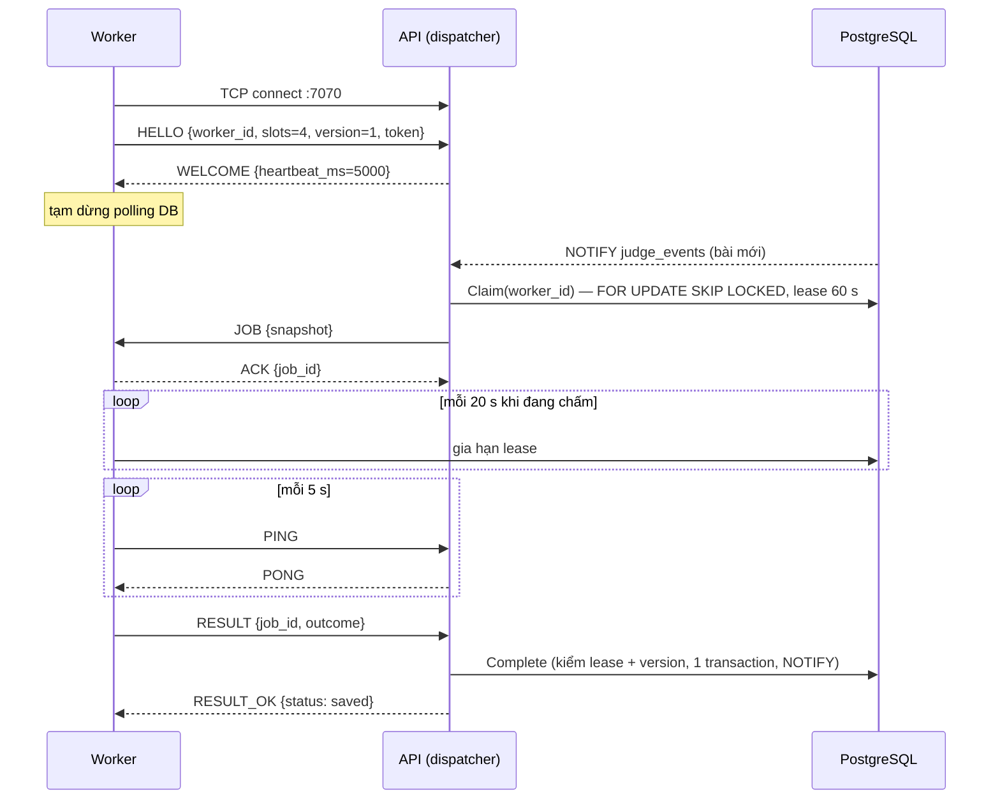

# Giao thức socket tự thiết kế

Ba giao thức dưới đây được viết trực tiếp trên socket của Go (`net`, chỉ thư viện chuẩn), không qua HTTP hay thư viện hàng đợi. Cả ba đều **bật/tắt bằng biến môi trường**; tắt hết thì hệ thống chạy như trước (worker polling PostgreSQL, thông báo chỉ qua WebSocket).

| # | Giao thức | Tầng vận chuyển | Ai ↔ ai | Bật bằng | Mã nguồn |
|---|---|---|---|---|---|
| 1 | Phân phối job chấm | TCP, khung có độ dài | API (dispatcher) ↔ worker | `DISPATCH_ADDR`, `WORKER_DISPATCH_ADDR` | `internal/wire`, `internal/dispatch` |
| 2 | Tìm máy chủ trong LAN | UDP broadcast | API → mọi máy; máy SV → API | `DISCOVERY_PORT` | `internal/discovery`, `cmd/lannet` |
| 3 | Thông báo của GV | UDP multicast | API → nhóm 239.255.42.99 | `ANNOUNCE_MULTICAST_ADDR` | `internal/mcast`, `cmd/lannet` |

---

## 1. Phân phối job chấm qua TCP (API → worker)

### 1.1. Ý tưởng

Trước đây mỗi worker tự hỏi PostgreSQL ("có job không?") theo chu kỳ hoặc khi có `NOTIFY`. Với giao thức này, worker **mở một kết nối TCP lâu dài tới API**; API giữ danh sách worker đang kết nối và số slot trống của từng worker, và **đẩy job** cho worker còn nhiều slot trống nhất.

PostgreSQL vẫn là **nguồn sự thật**:

* Dispatcher claim job trong DB **thay mặt** worker (`judge_jobs.worker_id` = id của worker, cùng lease 60 s như polling), rồi gửi snapshot job qua TCP.
* Worker vẫn tự gia hạn lease trong DB khi đang chấm (heartbeat lease), nên mất lease thì dừng chấm như cũ.
* Kết quả đi ngược về dispatcher qua TCP; dispatcher ghi vào DB (một transaction, chỉ khi còn lease và đúng version).
* Mất kết nối ⇒ worker **tự ghi kết quả vào DB** và **quay lại polling**; job không ai hoàn thành được phục hồi khi hết lease, đúng cơ chế cũ.

### 1.2. Khung (framing)

TCP là luồng byte, không có ranh giới message. Mỗi message được đóng khung:

```text
 0               4    5
 +---------------+----+---------------------------------+
 | length uint32 |type| payload: JSON (length-1 byte)   |
 | big-endian    |u8  |                                 |
 +---------------+----+---------------------------------+
```

* `length` = 1 (byte type) + độ dài payload; payload rỗng ⇒ `length = 1`.
* `length = 0` hoặc `> 4 MiB` ⇒ lỗi, đóng kết nối (chặn khung giả làm cấp phát bộ nhớ lớn).
* Bên đọc dùng `io.ReadFull` cho header rồi cho thân, nên một message bị TCP cắt thành nhiều segment (hoặc nhiều message dính nhau) vẫn được tách đúng (`internal/wire/wire_test.go`).
* Mỗi khung được ghi bằng **một** lệnh `Write` dưới mutex, có write deadline 5 s.

### 1.3. Loại message

| Mã | Tên | Chiều | Payload |
|---|---|---|---|
| `0x01` | HELLO | W → A | `{"worker_id","slots","version":1,"token"}` |
| `0x02` | WELCOME | A → W | `{"server","heartbeat_ms":5000}` |
| `0x03` | JOB | A → W | snapshot job: `JobID, RunID, SubmissionID, ProblemVersion, LeaseToken, SourcePath, TimeLimitMs, MemoryLimitMb, Tests[]...` |
| `0x04` | ACK | W → A | `{"job_id","accepted":true}` |
| `0x05` | RESULT | W → A | `{"job_id","outcome":{Verdict,PassedTests,TotalTests,Tests[]...}}` hoặc `{"job_id","error":"..."}` (lỗi hạ tầng, sẽ retry) |
| `0x06` | RESULT_OK | A → W | `{"job_id","status":"saved"\|"dropped"\|"unknown"\|"error"}` |
| `0x07` | PING | cả hai | rỗng |
| `0x08` | PONG | cả hai | rỗng |
| `0x09` | ERROR | A → W | `{"message"}`, sau đó đóng kết nối |

### 1.4. Trình tự



### 1.5. Xử lý lỗi

| Tình huống | Xử lý |
|---|---|
| HELLO sai version / sai token / thiếu worker_id / slots ngoài 1–64 / không gửi trong 5 s | ERROR rồi đóng |
| Worker cũ kết nối lại khi socket cũ chưa bị phát hiện chết | kết nối mới thay kết nối cũ (theo `worker_id`) |
| Không nhận được khung nào trong 3 × heartbeat (15 s) | coi như chết, đóng (cả hai phía) |
| JOB gửi đi nhưng không có ACK trong 10 s | dispatcher trả job về hàng đợi (`Fail`) và đóng kết nối |
| Kết nối đứt trước ACK | job chưa ACK được trả về hàng đợi ngay |
| Kết nối đứt sau ACK | worker chấm tiếp, gia hạn lease trong DB, rồi **tự ghi kết quả vào DB** |
| Không có RESULT_OK trong 15 s, hoặc status `unknown`/`error` | worker tự ghi vào DB (nếu dispatcher đã ghi rồi thì lần ghi sau bị bỏ vì lease đã hết: không bao giờ ghi hai lần) |
| API tắt | worker quay lại polling, thử kết nối lại với backoff 1 s → 15 s |
| Worker vừa claim job bằng polling ngay trước khi kết nối | job đẩy tới chờ slot trống (slot dùng chung cho cả hai đường) |

### 1.6. Bảo mật

`DISPATCH_TOKEN` là bí mật dùng chung, so sánh thời gian hằng (`crypto/subtle`). Không có token thì bất kỳ máy nào tới được cổng 7070 đều có thể giả làm worker để nhận mã nguồn và trả kết quả giả. Trong Compose mặc định cổng 7070 **không** publish ra LAN (worker tới bằng `api:7070` trên mạng nội bộ `db`).

### 1.7. Cấu hình

| Biến | Tiến trình | Ý nghĩa |
|---|---|---|
| `DISPATCH_ADDR` | api | địa chỉ lắng nghe, vd. `:7070`; rỗng = tắt |
| `DISPATCH_TOKEN` | api, worker | bí mật dùng chung |
| `WORKER_DISPATCH_ADDR` | worker | `host:port`, `auto` (tìm bằng UDP discovery, §2), hoặc rỗng = chỉ polling |

---

## 2. Tìm máy chủ trong LAN bằng UDP broadcast

### 2.1. Ý tưởng

Máy SV (hoặc worker ở máy khác) không cần biết trước IP máy chủ. API mở UDP `DISCOVERY_PORT` (mặc định khi bật: 9999) và:

1. **Quảng bá định kỳ** (mặc định 5 s) một datagram `announce` tới địa chỉ broadcast có hướng của từng card mạng IPv4 (vd. `192.168.1.255` cho `192.168.1.0/24`, tính bằng `ip | ^mask`). Mỗi card gửi kèm IP của chính card đó, nên máy nhận luôn thấy địa chỉ trong mạng con của mình.
2. **Trả lời thăm dò**: client gửi `discover` tới `255.255.255.255:9999` và các địa chỉ broadcast; API trả lời `announce` **unicast** về đúng địa chỉ nguồn, chọn IP của card nằm cùng mạng con với client.

Socket được mở với `SO_REUSEADDR` để API và một máy đang `lannet watch` dùng chung cổng trên cùng máy.

### 2.2. Định dạng datagram

Một đối tượng JSON trong một datagram (≤ 2 KB), luôn có `"magic":"LANLAB/1"`; datagram khác bị bỏ qua.

```json
{"magic":"LANLAB/1","type":"discover"}

{"magic":"LANLAB/1","type":"announce","name":"lab-server","seq":42,
 "http":"http://192.168.1.9:8080","https":"https://192.168.1.9:8443",
 "dispatch":"192.168.1.9:7070","multicast":"239.255.42.99:9998"}
```

`seq` tăng dần để phân biệt bản tin mới/cũ. UDP có thể mất hoặc lặp gói: client chỉ giữ bản tin mới nhất cho mỗi máy chủ, và thăm dò lại nếu chưa ai trả lời.

### 2.3. Dùng

```bash
go run ./cmd/lannet discover          # gửi discover, in các máy chủ trả lời trong 2 s
go run ./cmd/lannet watch             # nghe bản tin quảng bá định kỳ
WORKER_DISPATCH_ADDR=auto ./worker    # worker tự tìm dispatcher
```

| Biến | Ý nghĩa |
|---|---|
| `DISCOVERY_PORT` | cổng UDP, `0` = tắt |
| `DISCOVERY_INTERVAL` | chu kỳ quảng bá (mặc định 5 s) |
| `ADVERTISE_HOST` | IP/tên quảng bá cố định (mặc định: mục đầu của `TLS_HOSTS`, nếu không có thì IP từng card) |

---

## 3. Thông báo của GV qua UDP multicast

### 3.1. Ý tưởng

Khi GV gửi thông báo, API vẫn đẩy qua WebSocket như cũ (đáng tin cậy, theo phiên) **và** gửi thêm **một** datagram tới nhóm multicast `ANNOUNCE_MULTICAST_ADDR` (vd. `239.255.42.99:9998`, dải 239/8 dành cho phạm vi tổ chức). Mọi máy đã tham gia nhóm (IGMP join qua `net.ListenMulticastUDP`) đều nhận, dù 5 hay 50 máy: máy chủ chỉ gửi một lần thay vì một lần cho mỗi kết nối. TTL mặc định 1 giữ gói trong mạng con của phòng máy.

### 3.2. Định dạng

```json
{"magic":"LANLAB/1","type":"announcement","server":"lab-server","seq":7,
 "id":12,"session_id":3,"text":"Còn 10 phút","created_at":"2026-10-31T09:50:00+07:00"}
```

Gửi kiểu "best effort": lỗi gửi multicast chỉ ghi log, không làm hỏng việc tạo thông báo. `seq` liên tục cho phép bên nhận phát hiện gói bị mất (`lannet` in `missed N datagram(s)`); bản đầy đủ luôn lấy lại được qua REST/WebSocket.

```bash
go run ./cmd/lannet announcements -group 239.255.42.99:9998 [-iface wlan0]
```

---

## 4. Chạy với Docker

Trong `docker-compose.yml` mặc định: API lắng nghe `:7070`, worker kết nối `api:7070` (TCP hoạt động trong mạng nội bộ của Compose). **Broadcast và multicast không đi qua được bridge NAT của Docker**, nên để demo §2–3 với các máy thật trong LAN dùng thêm file override cho API chạy chung mạng với máy chủ:

```bash
docker compose -f docker-compose.yml -f docker-compose.lan.yml up -d --build
sudo ufw allow 9999/udp && sudo ufw allow 9998/udp      # nếu dùng ufw
```

Khi đó cổng 7070 nằm trên mạng của máy chủ: **đặt `DISPATCH_TOKEN`**.

## 5. Kiểm thử

| Test | Kiểm tra |
|---|---|
| `internal/wire` | đóng/mở khung, khung rỗng/quá lớn/cụt, đọc từng byte một |
| `internal/dispatch` (unit) | 2 worker nhận 10 job qua TCP, kết quả do dispatcher ghi; dispatcher chết giữa chừng ⇒ worker tự ghi DB; HELLO sai bị từ chối; JOB không ACK ⇒ trả về hàng đợi |
| `internal/dispatch` (integration, PostgreSQL thật) | 2 worker TCP + 1 worker polling cùng hàng đợi: 30 bài, mỗi job chấm đúng một lần (`attempt_count = 1`) |
| `internal/discovery` | tính địa chỉ broadcast, bỏ datagram lạ, thăm dò nhận được trả lời |
| `internal/mcast` | từ chối địa chỉ không phải multicast; gửi/nhận qua loopback multicast (tự bỏ qua khi tường lửa chặn) |
